# Dashboard Guide — Every Control, Explained

Screenshots captured from the **live Azure deployment**:
<https://spraytrace.ambitiousfield-440a14b7.eastasia.azurecontainerapps.io>

Captured 6 October 2026 against the shipped dataset (11,229 events, 29 campaigns).
The local dashboard at `http://localhost:5173` after `./run.sh` is identical — the
same build is served in both places.

---

## Contents

- [The whole screen](#the-whole-screen)
- [A · Top bar and its three buttons](#a--top-bar-and-its-three-buttons)
- [B · Statistics bar](#b--statistics-bar)
- [C · Campaign list](#c--campaign-list)
- [D · Campaign detail pane](#d--campaign-detail-pane)
- [E · Attack graph](#e--attack-graph)
- [F · Replay timeline](#f--replay-timeline)
- [G · Event table](#g--event-table)
- [Walkthroughs](#walkthroughs)
- [Keyboard, URL and mouse reference](#keyboard-url-and-mouse-reference)
- [Control-to-API map](#control-to-api-map)
- [Screenshot index](#screenshot-index)

---

## The whole screen

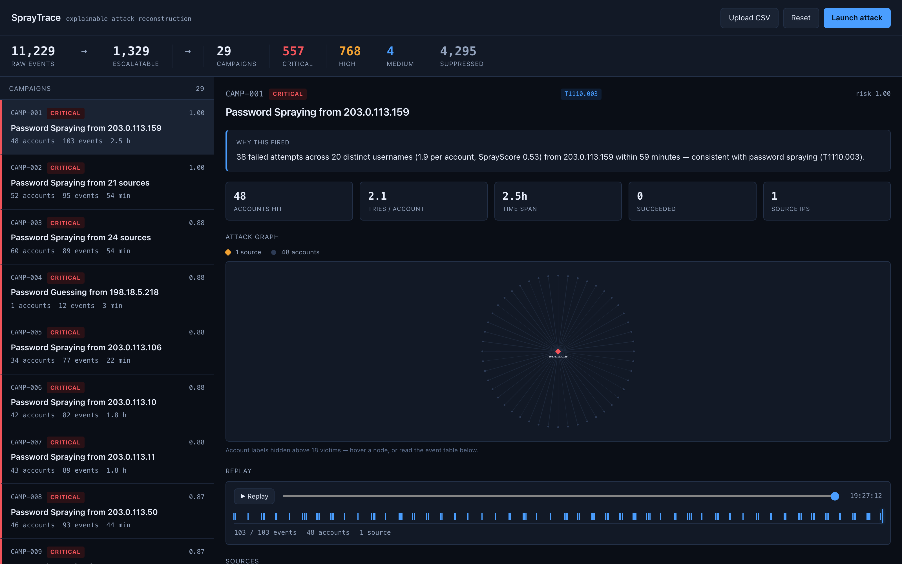

Four regions, top to bottom:

```
┌──────────────────────────────────────────────────────────────────────┐
│ A   SprayTrace            [Upload CSV] [Reset] [Launch attack]       │
├──────────────────────────────────────────────────────────────────────┤
│ B   11,229 → 1,329 → 29    557 CRITICAL  768 HIGH  4 MED  4,295 SUPP │
├──────────────────┬───────────────────────────────────────────────────┤
│ C  CAMPAIGNS 29  │ D   CAMP-001  CRITICAL  T1110.003     risk 1.00   │
│  ┌────────────┐  │     Password Spraying from 203.0.113.159          │
│  │ CAMP-001   │  │     ┌───────────────────────────────────────────┐ │
│  │ CRITICAL   │  │     │ WHY THIS FIRED — evidence sentence        │ │
│  └────────────┘  │     └───────────────────────────────────────────┘ │
│  ┌────────────┐  │     [48 accounts][2.1 tries][2.5h][0 ok][1 IP]    │
│  │ CAMP-002   │  │  E  ATTACK GRAPH                                  │
│  └────────────┘  │  F  REPLAY  ▶ ────────●──── 19:27:12              │
│      …           │  G  EVENTS table                                  │
└──────────────────┴───────────────────────────────────────────────────┘
```

The layout is deliberate: **the reduction claim is at the top, the reason an alert
fired is at the top of the detail pane.** The product claim is explainability, so
the explanation leads — you never have to scroll to find out why something fired.

---

## A · Top bar and its three buttons

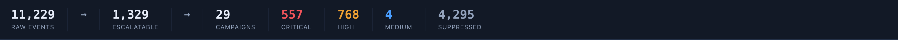

| Control | What it does | What happens on screen |
|---|---|---|
| **Upload CSV** | Opens a file picker. The chosen CSV is uploaded, the full pipeline re-runs on it, and the dashboard switches to those results. | Spinner appears; banner reports filename, event count, **detected format**, and campaigns found. The campaign list repopulates. |
| **Reset** | Discards any uploaded or injected data and returns to the shipped generated dataset. | Spinner; banner reads *"Reset to the generated dataset."* Counts return to 11,229 / 29. |
| **Launch attack** | **The demo button.** Plants a live password-spray campaign into the in-memory data, re-runs the entire pipeline, and auto-selects whatever campaign the detectors produce. | Counts increase; a blue banner names the injected campaign; the new campaign is selected and briefly highlighted. |

### Upload CSV — detail

Accepts two formats, and **detects which one it is given from the header row**:

1. **Canonical** — the 10-column schema in [data_spec.md](data_spec.md)
2. **Microsoft Entra ID sign-in log export** — mapped automatically

The banner states which format was detected, e.g. *"signins.csv: 4,210 events
(entra format) → 7 campaigns."* This is the point: an Entra export flows through
completely unchanged, because nothing downstream of the reader knows which format
arrived.

**Note on scope:** uploads replace the in-memory analysis only. The files in
`data/raw/` are never modified.

### Launch attack — detail


> *Injected 90 events against 45 accounts from 198.51.100.66 — detected as
> CAMP-013 (critical).*

This is the strongest thing to show live, because the attack **did not exist**
when the page loaded. It is generated, detected, scored, correlated and explained
in one click — nothing is pre-computed.

Comparing before and after:

| | Before | After |
|---|---:|---:|
| Raw events | 11,229 | **11,319** (+90) |
| Escalatable | 1,329 | **1,419** (+90) |
| Campaigns | 29 | **30** (+1) |
| Critical | 557 | **596** |

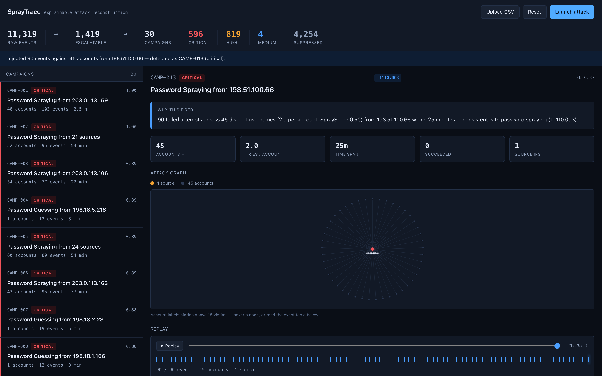

The campaign it created, selected automatically:

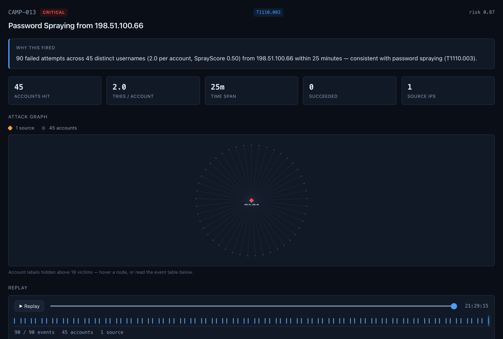

Every number in the evidence sentence — 90 attempts, 45 usernames, 2.0 per
account, SprayScore 0.50, 25 minutes — was computed from the events just planted.

**Spinner.** While any of the three buttons is working, a spinner appears in the
top bar and **all three buttons are disabled**, so a second click cannot race the
first.

---

## B · Statistics bar


Two groups. The first is the **reduction story**, read left to right:

| Figure | Meaning |
|---|---|
| **11,229** raw events | every authentication event loaded |
| → **1,329** escalatable | events scoring ≥ 0.40, above the gate |
| → **29** campaigns | **what a human actually reads** |

That progression is the product in one line: 11,229 things become 29 things.

The second group is the **tier breakdown**:

| Figure | Colour | Meaning |
|---|---|---|
| **557** critical | red | risk ≥ 0.80 — auto-escalate with evidence |
| **768** high | amber | 0.60 – 0.80 — auto-escalate |
| **4** medium | blue | 0.40 – 0.60 — analyst review queue |
| **4,295** suppressed | grey | below 0.40 — **retained, not deleted** |

**Hover "suppressed"** for the tooltip: *"Below the 0.40 gate: never escalated,
retained for retrospective hunting."*

Suppressed events remain queryable at `/api/audit`. This is the honest part of the
design — a gate whose suppressions nobody can inspect is a claim, not a control,
and this is exactly where a missed low-scoring campaign would be found.

These numbers are not static labels; they update after every upload, injection
and reset.

---

## C · Campaign list

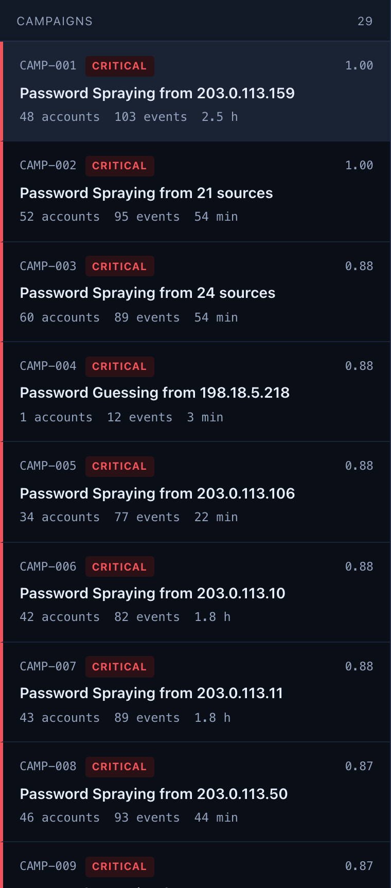

The left pane. Campaigns are **sorted by risk, highest first**, so the worst
incident is always the top card. The header shows the total count.

### Reading one card

```
┌──────────────────────────────────────────────┐
│ CAMP-001   [CRITICAL]                  1.00  │   ← id · tier badge · risk
│ Password Spraying from 203.0.113.159         │   ← what it is
│ 48 accounts   103 events   2.5 h             │   ← scale · volume · duration
└──────────────────────────────────────────────┘
   ↑ coloured left border = tier
```

| Element | Meaning |
|---|---|
| `CAMP-001` | campaign identifier; also the URL fragment |
| Tier badge | CRITICAL / HIGH / MEDIUM, coloured |
| `1.00` | fused risk score, 0.00 – 1.00 |
| Title | attack type and origin — *"from 203.0.113.159"* for one source, *"from 21 sources"* for a distributed campaign |
| `48 accounts` | distinct accounts targeted |
| `103 events` | authentication events in this campaign |
| `2.5 h` | span from first to last event (minutes under an hour) |
| Left border | tier colour, readable at a glance while scrolling |

### Interaction

| Action | Result |
|---|---|
| **Click a card** | Loads it into the detail pane; URL hash updates to `#CAMP-001` |
| **Selected card** | Lighter background, brighter border |
| **Freshly injected** | Highlighted for ~2 seconds after "Launch attack" |
| **Scroll** | The list scrolls independently of the detail pane |

**Reading the titles tells you the story.** *"Password Spraying from
203.0.113.159"* is a single-source spray. *"Password Spraying from 21 sources"* is
a distributed campaign that a per-IP counter would never catch. *"Password
Guessing from 198.18.5.218"* with `1 accounts` is classic brute force.

**If there are no campaigns**, the pane reads *"No campaigns above the escalation
gate."* — which is the correct output for clean traffic, not an error.

---

## D · Campaign detail pane

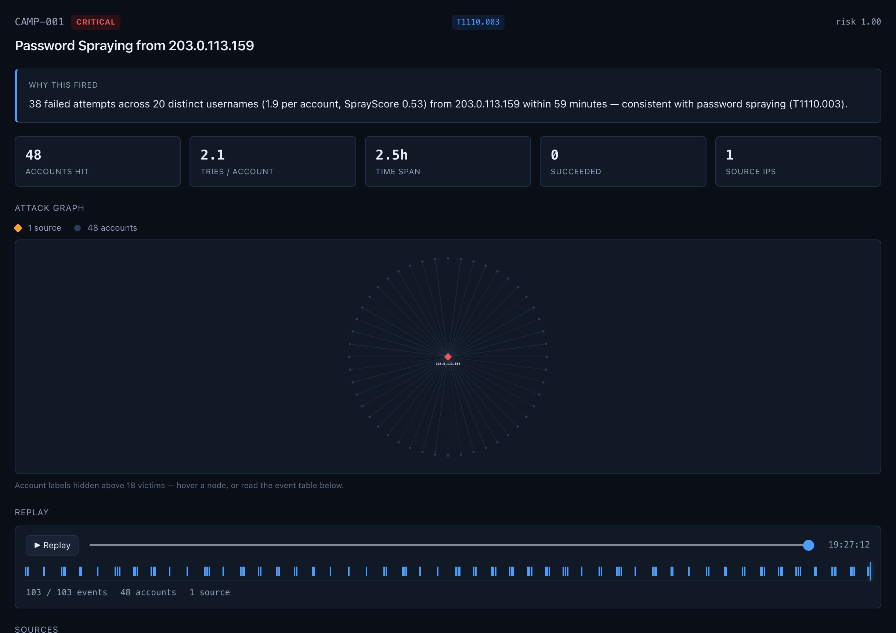

### Header row

| Element | Meaning |
|---|---|
| `CAMP-001` | campaign id |
| `CRITICAL` | tier badge |
| `T1110.003` | **MITRE ATT&CK technique ID** — the industry-standard catalogue entry |
| `risk 1.00` | fused risk score |
| Title | human-readable description |

ATT&CK IDs used: **T1110.001** password guessing (brute force) · **T1110.003**
password spraying · **T1078** valid accounts (impossible travel).

### "Why this fired" — the evidence box


> *38 failed attempts across 20 distinct usernames (1.9 per account, SprayScore
> 0.53) from 203.0.113.159 within 59 minutes — consistent with password spraying
> (T1110.003).*

**This is the single most important element in the interface** and it is placed
first for that reason.

Every number in it is the number that **triggered the detection** — not a summary
written afterwards. The sentence is generated inside the detector, next to the
computation, so the explanation structurally cannot drift from the detection.
There is no second code path that could describe an alert differently from how it
was actually produced.

For a distributed campaign the sentence names the evasion explicitly:

> *133 failed attempts across 60 distinct usernames from 22 source addresses (2.2
> per account, 6.0 per source, SprayScore 0.45) within 59 minutes — distributed
> password spraying: **no single source exceeds a per-IP threshold** (T1110.003).*

### Metric tiles

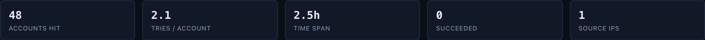

| Tile | Meaning | Watch for |
|---|---|---|
| **Accounts hit** | distinct accounts targeted | high + low tries = spray |
| **Tries / account** | failures ÷ accounts | ≤ 3 is spray-shaped; high is brute force |
| **Time span** | first to last event | a short span with wide breadth is automation |
| **Succeeded** | successful sign-ins **inside the campaign** | **any non-zero turns this tile amber — the attacker got in** |
| **Source IPs** | distinct addresses | 1 = single source; 20+ = distributed |

The **Succeeded** tile is the one to look at first in a real investigation. `0`
means an attempted breach. Anything above `0` means a successful one, and the tile
changes colour to say so.

---

## E · Attack graph

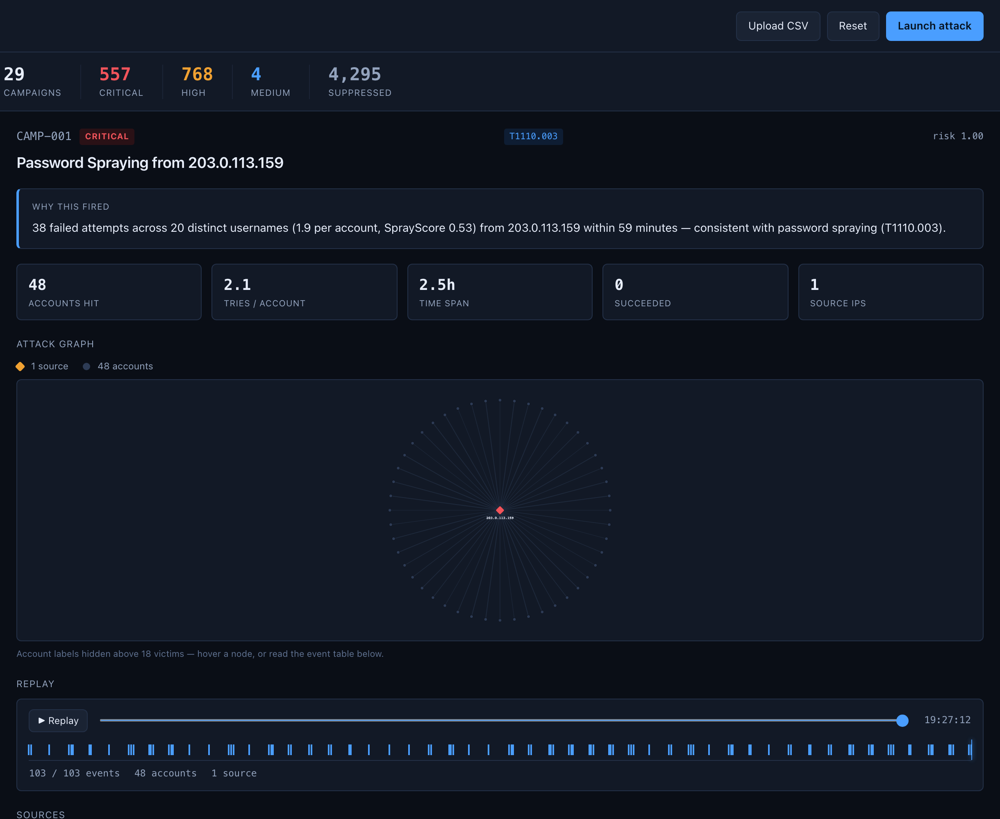

An interactive node-link graph (Cytoscape). **The shape is the diagnosis** — an
analyst reads it faster than any table.

| Element | Meaning |
|---|---|
| 🔶 **Diamond** | a source address (attacker) — coloured by campaign tier |
| ⚪ **Small grey circle** | a targeted account (victim) |
| ⭐ **Red star** | a **compromised** account — one where a sign-in succeeded. Larger, red, and a different shape, so it is unmissable |
| **Grey line** | failed attempts from that source against that account |
| **Red line** | an edge where at least one attempt **succeeded** |
| **Line thickness** | scales with the number of attempts on that pair |
| **Node size** | sources shrink from 26px to 16px when a campaign has more than 6 of them, so a 28-address pool reads as many small nodes rather than one blob |

The layout is **concentric**: sources on an inner ring, victims on an outer one. A
single source sits alone at the centre and its fan reads as a star; a rotating
pool spreads across the inner ring. The two attack shapes therefore stay
distinguishable at a glance instead of collapsing into one mass.

The legend above the canvas counts sources and accounts, and adds an amber
*"n succeeded"* entry only when there has been a breach.

### Reading the shape

| Shape | Diagnosis |
|---|---|
| One hub, wide fan of spokes | **password spray** — one source, many accounts |
| One thick single edge | **brute force** — one source, one account, many tries |
| Many hubs sharing victims | **distributed spray** — the per-IP-evading case |

Compare the single-source spray above with a distributed campaign:

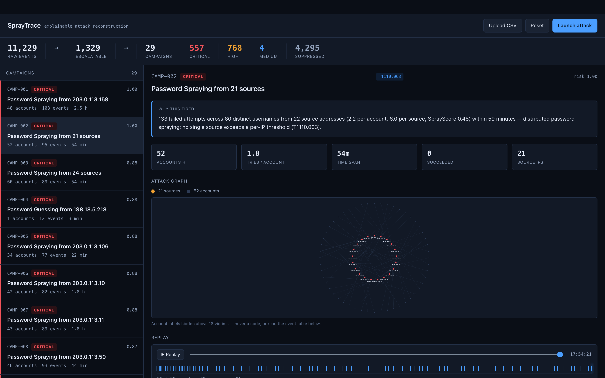

21 source diamonds scattered across the canvas, all connecting into a shared pool
of 52 victim accounts. That interlocking mesh is what a per-IP threshold cannot
see — each individual diamond is unremarkable.

### Interaction

| Action | Result |
|---|---|
| **Drag a node** | Reposition it; connected edges follow |
| **Scroll / pinch** | Zoom (limited to 0.3× – 2.5×) |
| **Drag the background** | Pan the canvas |

**Labels.** Source diamonds are always labelled with their IP address. Account
labels are shown only when a campaign has **18 victims or fewer** — past that they
become an unreadable ring, so the fan itself carries the meaning and the names are
read from the event table below.

> **Known gap:** the caption under the canvas reads *"hover a node"*, but no hover
> tooltip is implemented — hovering does nothing. Use the event table for names on
> large campaigns. This is a wording bug in the caption, not a missing feature in
> the analysis.

---

## F · Replay timeline

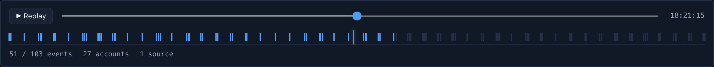

Plays the campaign forward in time. This shows the attack **arriving** rather than
sitting finished — and the moment breadth becomes obvious is the moment an analyst
cares about.

| Control | Function |
|---|---|
| **▶ Replay** | Plays from the current position. The whole campaign takes ~4 seconds regardless of length, so a 2-event travel pair and a 100-event spray both read at a watchable pace. |
| **❚❚ Pause** | The same button while playing; stops at the current frame. |
| **Scrub slider** | Drag to any moment. Dragging **pauses playback automatically**. |
| **Clock** `19:27:12` | Timestamp of the event at the playhead. |
| **Tick marks** | One per event, positioned by **real elapsed time** — so clustering in the track is genuine burst density, not even spacing. |
| **Blue ticks** | Events already reached by the playhead. |
| **Red ticks** | A **successful** sign-in — a breach moment. |
| **Playhead** | Current position in the track. |

### Live counters

Below the track, updating as it plays:

```
57 / 103 events     31 accounts     1 source     2 succeeded
```

Watching `accounts` climb while `tries per account` stays near 2 is the visual
signature of a spray. The `succeeded` counter appears in amber only when a
successful sign-in has been reached.

### The event table follows the playhead

**While scrubbing, the events table below shows only events up to the playhead.**
The graph, the timeline and the table all describe the same moment, so there is no
mismatch between what is playing and what is listed. Its heading reads
*"Events (57 of 103)"* while scrubbed.

Pressing **▶ Replay** at the end automatically rewinds to the start.

---

## G · Event table

The raw evidence, under the heading **Events (n)**.

| Column | Contents |
|---|---|
| **Time** | event timestamp |
| **Account** | the targeted username |
| **Source** | originating IP address |
| **Location** | city, country |
| **Result** | `success` (green) or `failed` (red) |
| **Risk** | that single event's fused risk score |

Above it, a **Sources** line lists every distinct source address in the campaign —
for a distributed campaign, this is the full rotating pool, as plain text that can
be copied into a block list.

This table is the audit trail. Every claim in the evidence sentence can be checked
against these rows.

---

## Walkthroughs

### 1 · The 60-second demonstration

1. **Open the dashboard.** Point at the stat bar: *"11,229 events became 29
   campaigns."*
2. **Click CAMP-001.** Read the "Why this fired" sentence aloud — it is a complete
   explanation in one line.
3. **Point at the attack graph** — one diamond, 48 spokes. *"That shape is a
   spray."*
4. **Click "Launch attack."** Counts rise, a new campaign appears and is selected.
   *"That attack did not exist when this page loaded."*
5. **Press ▶ Replay.** Watch the account counter climb while tries-per-account
   stays at 2.

### 2 · Showing the distributed detector (the technical highlight)

1. Find a campaign titled **"Password Spraying from 21 sources."**
2. Read its evidence: *"no single source exceeds a per-IP threshold."*
3. Point at the **Source IPs** tile: `21`. Then **tries per account**: `1.8`.
4. Point at the graph: 21 separate diamonds into one shared victim pool.
5. *"A per-IP counter sees 21 unremarkable addresses. We group by time window
   instead, so rotating IPs does not help the attacker."*

### 3 · Analysing your own logs

1. Click **Upload CSV**, choose a canonical or Entra export.
2. Read the banner — it confirms the detected format and campaign count.
3. Work down the campaign list from the top; it is already risk-ordered.
4. Check the **Succeeded** tile on each — non-zero means act now.
5. Copy the **Sources** line for blocking.
6. Click **Reset** to return to the demonstration dataset.

---

## Keyboard, URL and mouse reference

| Input | Effect |
|---|---|
| `#CAMP-007` in the URL | Deep-links straight to that campaign — shareable, and survives a page reload |
| `Tab` / `Shift+Tab` | Move between buttons and campaign cards (all controls are real focusable elements) |
| `Enter` / `Space` on a focused card | Select that campaign |
| `←` / `→` on the focused scrub slider | Step the replay one event at a time |
| Scroll wheel over the graph | Zoom |
| Drag on graph background | Pan |
| Hover a timeline tick | Timestamp, account and result |
| Hover "suppressed" | Explains the audit-log retention policy |

The selection is written into the URL hash on every change, so a specific campaign
can be sent to a colleague as a link.

### Narrow screens

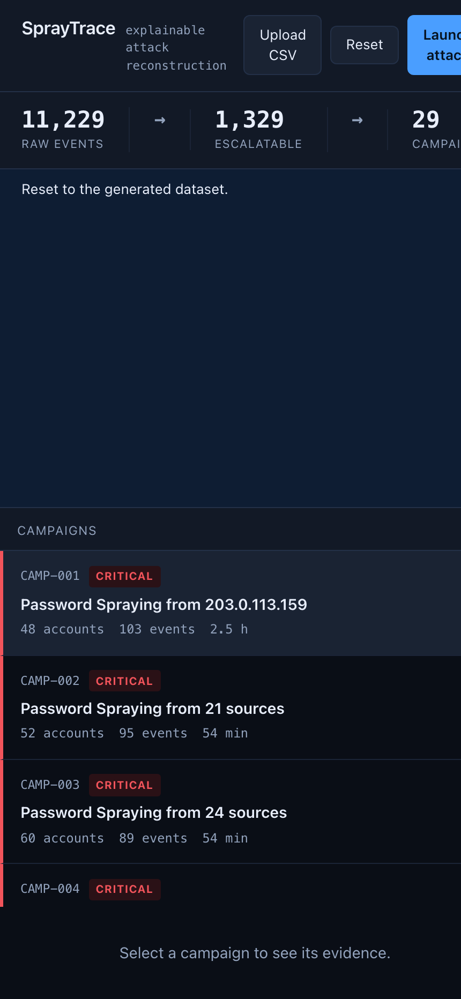

The layout reflows to a single column on phone-width screens; the panes stack
rather than sitting side by side.

---

## Control-to-API map

Every control is a thin wrapper over a documented endpoint
([api_spec.md](api_spec.md)). The dashboard holds no detection logic of its own.

| Control | Endpoint |
|---|---|
| Page load | `GET /api/summary` + `GET /api/campaigns` |
| Click a campaign card | `GET /api/campaigns/{id}` |
| **Upload CSV** | `POST /api/analyze` |
| **Launch attack** | `POST /api/inject` |
| **Reset** | `POST /api/reset` |
| Replay timeline | served inside the campaign detail payload |
| (no UI control) | `GET /api/audit` — suppressed events |
| (no UI control) | `GET /api/events` — filter by tier, username, source IP, technique |
| (no UI control) | `GET /api/metrics` — the evaluation table |
| (no UI control) | `GET /api/users/{username}` — one user's risk history |

The last four are available for scripted analysis; `/api/audit` in particular is
how a suppressed low-risk campaign would be recovered.

---

## Screenshot index

All images are in [docs/screenshots/](screenshots/), captured from the live Azure
deployment at 1600×1000 and 2× pixel density.

| File | Shows |
|---|---|
| `01-dashboard-overview.png` | Full dashboard, CAMP-001 selected |
| `02-statbar.png` | Statistics bar close-up |
| `03-campaign-list.png` | Campaign list pane |
| `04-campaign-detail.png` | Full detail pane |
| `05-evidence.png` | "Why this fired" evidence box |
| `06-metrics.png` | Five metric tiles |
| `07-attack-graph.png` | Single-source spray graph |
| `08-replay-midpoint.png` | Replay timeline, scrubbed to the midpoint |
| `09-distributed-campaign.png` | Distributed campaign, 21 sources |
| `10-launch-attack-injected.png` | Dashboard after a live injection |
| `11-injection-banner.png` | Injection confirmation banner |
| `12-after-reset.png` | Dashboard restored by Reset |
| `13-narrow-viewport.png` | Narrow / mobile layout |
| `14-injected-campaign-detail.png` | The injected campaign's own detail pane |
